# B01 üretim paketi — klipler

Flow ayarı her klip için aynı: **kareden videoya · Veo 3.1 Lite · 9:16**. Başlangıç karesi olarak yalnızca aşağıda yazan kareyi yükle; karakter sayfası, ifade sayfası ya da plaka ekleme.

| Klip | Başlangıç karesi | Süre | Durum |
|---|---|---|---|
| P01 | SB01 | 4 sn | Hazır |
| P02 | SB02 | 4 sn | Hazır |
| P03 | SB03 | 6 sn | Hazır |
| P04 | SB04 | 4 sn | Hazır |
| P05 | SB05 | 8 sn | Hazır |
| P06a | SB06 | 6 sn | Hazır |
| P06b | P06a'nın son karesi | 6 sn | Kare bekleniyor |
| P07 | SB01 | 4 sn | Hazır |
| P08 | SB08 | 6 sn | Hazır |
| P09 | SB09 | 4 sn | Hazır |
| P10 | SB10 | 6 sn | Hazır |
| P11 | SB11 | 4 sn | Hazır |
| P12 | SB12 | 4 sn | Hazır |
| P13 | SB10 | 6 sn | Hazır |
| P14 | SB14 | 6 sn | Hazır |

## P01

**Başlangıç karesi:** SB01 · **Süre:** 4 sn

Dosya: `klipler/P01/P01_baslangic_karesi_SB01.jpg`

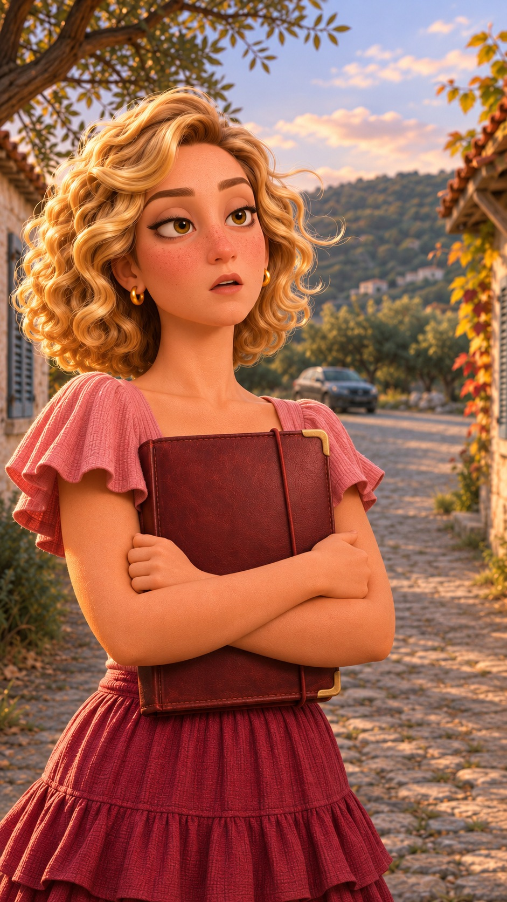

Prompt:

```
Stylized 3D animated feature film look, single continuous shot. Camera is locked off for the whole shot: no pan, no zoom, no cut. Duration 4 seconds.

Start exactly from the first frame: waist-up shot of Selin alone, slightly left of center, hugging a burgundy folder against her chest with both arms, frozen, staring at something far ahead past the right edge of the frame. A light breeze moves her curls.

Hands and objects (do not change):
- Selin keeps BOTH arms crossed over the burgundy folder against her chest for the entire shot. She makes no hand gestures. The folder never moves and keeps the same size.

Voices (must sound exactly the same in every clip of this series):
- Selin: Turkish woman in her early thirties. Calm, warm, slightly husky low voice. Dry, deadpan humor, never loud.

Every character is a native Turkish speaker. They speak ONLY Turkish, with a natural Istanbul accent and the lively, expressive delivery of actors in a Turkish animated comedy film. No English.

0-1 s: Selin stares ahead without blinking. A goat bleats once, off screen, far away.
1-3.5 s: Without moving her eyes, she says in Turkish, quiet and flat, with a pause after the name: "Rıza… bunun neresi şehir?"
3.5-4 s: She holds the stare. One slow blink.

Last frame: the same shot, Selin in the same place, still staring ahead, mouth closed, arms still crossed over the folder.

Eyes: Selin looks only at the far point ahead, past the right edge of the frame. Nobody looks at the camera. Faces, hair and clothes stay identical to the first frame.

Pronunciation: the name "Rıza" contains the Turkish dotless ı. Say it "RUH-zah", never "Riza" or "Reeza". "şehir" sounds like "sheh-HEER".

Only the speaking character's mouth moves. Audio: the voices and light wind and one distant goat bleat only. No music, no subtitles, no on-screen text.
```

## P02

**Başlangıç karesi:** SB02 · **Süre:** 4 sn

Dosya: `klipler/P02/P02_baslangic_karesi_SB02.jpg`

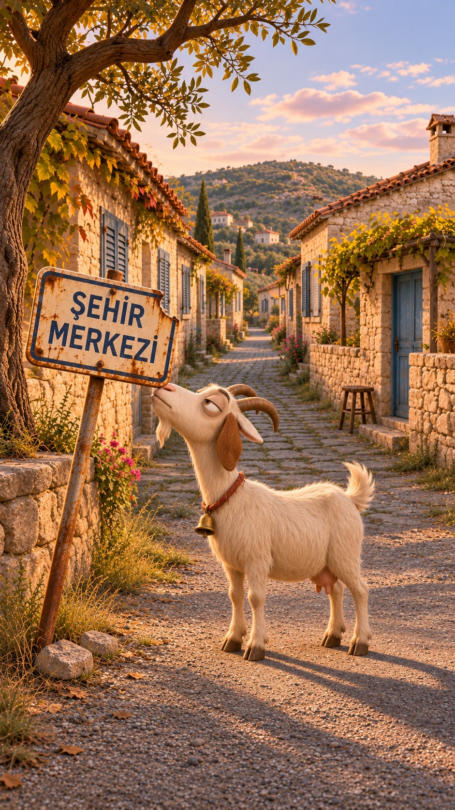

Prompt:

```
Stylized 3D animated feature film look, single continuous shot. Camera is locked off for the whole shot: no pan, no zoom, no cut. Duration 4 seconds.

Start exactly from the first frame: wide shot of the empty village entrance with the leaning road sign and the goat at its foot.

Hands and objects (do not change):
- The road sign stays standing, at the same angle, for the entire shot. Its text stays exactly "ŞEHİR MERKEZİ" and never changes.
- The goat stays at the foot of the sign and does not walk.

0-4 s: Nothing happens. A few dry leaves drift across the gravel. The sign creaks once in the wind. The goat chews slowly, ear flicking once. Its bell gives one soft tinkle.

Last frame: the same wide shot, sign standing, goat in the same place.

Eyes: The goat looks at the sign. Nobody looks at the camera. Faces, hair and clothes stay identical to the first frame.

No dialogue. Nobody speaks. Audio: light wind, one metal creak, one soft bell tinkle only. No music, no subtitles, no on-screen text.
```

## P03

**Başlangıç karesi:** SB03 · **Süre:** 6 sn

Dosya: `klipler/P03/P03_baslangic_karesi_SB03.jpg`

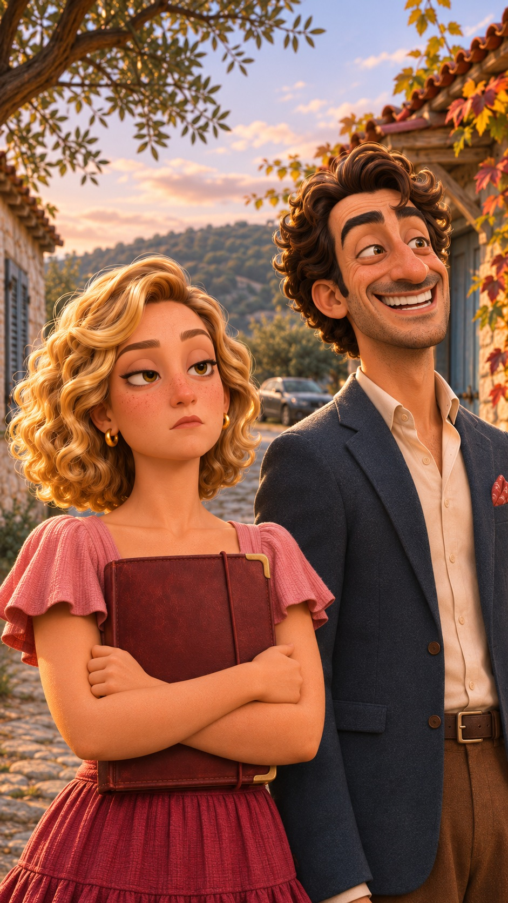

Prompt:

```
Stylized 3D animated feature film look, single continuous shot. Camera is locked off for the whole shot: no pan, no zoom, no cut. Duration 6 seconds.

Start exactly from the first frame: chest-up two-shot, Selin on the left hugging a burgundy folder, Rıza on the right grinning proudly; both look past the camera at the village.

Hands and objects (do not change):
- Selin keeps BOTH arms crossed over the burgundy folder against her chest for the entire shot. She makes no hand gestures. The folder never moves and keeps the same size.
- Rıza gestures only with his LEFT arm (the arm away from Selin, on the right side of the frame). His right arm stays down, out of frame.

Voices (must sound exactly the same in every clip of this series):
- Selin: Turkish woman in her early thirties. Calm, warm, slightly husky low voice. Dry, deadpan humor, never loud.
- Rıza: Turkish man in his mid thirties. Warm, bright, slightly nasal tenor. Talks fast, easily excited, salesman energy.

Every character is a native Turkish speaker. They speak ONLY Turkish, with a natural Istanbul accent and the lively, expressive delivery of actors in a Turkish animated comedy film. No English.

0-3 s: Rıza points with his LEFT arm toward something off screen on the right and says in Turkish, proud and overexcited: "Şehir merkezi burası aşkım! Bak, tabelası bile var."
3-5 s: Selin turns only her head toward Rıza and answers in Turkish, completely flat: "Tabelayı keçi yiyor, Rıza."
5-6 s: Nobody speaks. Rıza's grin freezes, his arm still half raised. Selin keeps looking at him.

Last frame: both stand exactly where they started; Selin looks at Rıza, Rıza looks ahead with a frozen grin.

Eyes: Rıza looks past the camera toward the right. Selin looks ahead, then at Rıza. Nobody looks at the camera. Faces, hair and clothes stay identical to the first frame.

Pronunciation: the name "Rıza" contains the Turkish dotless ı. Say it "RUH-zah", never "Riza" or "Reeza". "şehir" sounds like "sheh-HEER". "keçi" sounds like "keh-CHEE".

Only the speaking character's mouth moves. Audio: the voices and light wind only. No music, no subtitles, no on-screen text.
```

## P04

**Başlangıç karesi:** SB04 · **Süre:** 4 sn

Dosya: `klipler/P04/P04_baslangic_karesi_SB04.jpg`

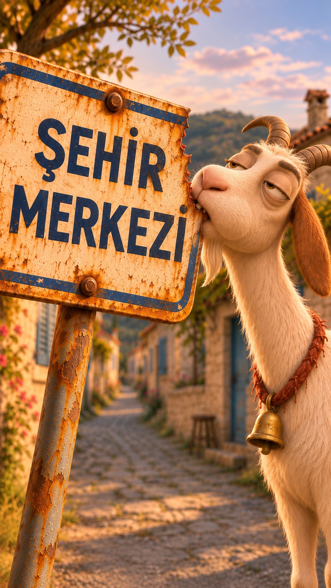

Prompt:

```
Stylized 3D animated feature film look, single continuous shot. Camera is locked off for the whole shot: no pan, no zoom, no cut. Duration 4 seconds.

Start exactly from the first frame: close shot of the goat's head biting the ragged top corner of the rusty road sign.

Hands and objects (do not change):
- The sign does not move or fall. Its text stays exactly "ŞEHİR MERKEZİ" and never changes.
- The goat's head stays at the corner of the sign.

0-4 s: The goat chews the metal corner slowly, jaw sliding sideways, eyes half closed. It blinks once. One ear flicks. The bell on its collar tinkles softly.

Last frame: the goat still chewing the same corner, the sign unchanged.

Eyes: The goat looks at nothing in particular. Nobody looks at the camera. Faces, hair and clothes stay identical to the first frame.

No dialogue. Nobody speaks. Audio: slow crunchy chewing, one soft bell tinkle, light wind only. No music, no subtitles, no on-screen text.
```

## P05

**Başlangıç karesi:** SB05 · **Süre:** 8 sn

Dosya: `klipler/P05/P05_baslangic_karesi_SB05.jpg`

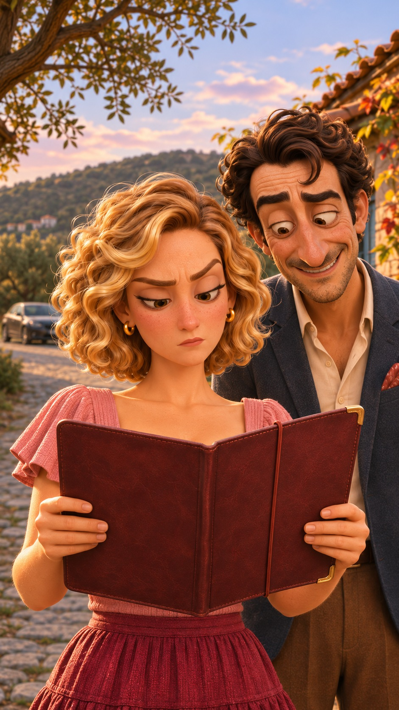

Prompt:

```
Stylized 3D animated feature film look, single continuous shot. Camera is locked off for the whole shot: no pan, no zoom, no cut. Duration 8 seconds.

Start exactly from the first frame: chest-up shot of Selin reading from an open burgundy folder held in both hands; Rıza leans in behind her on the right edge of the frame, peeking over her shoulder.

Hands and objects (do not change):
- Selin holds the open folder with BOTH hands, one on each edge, at chest height, for the entire shot. She never lets go, never closes it, never gestures. The folder keeps the same size. The camera only ever sees its burgundy outside.
- Rıza's hands stay out of the frame.

Voices (must sound exactly the same in every clip of this series):
- Selin: Turkish woman in her early thirties. Calm, warm, slightly husky low voice. Dry, deadpan humor, never loud.
- Rıza: Turkish man in his mid thirties. Warm, bright, slightly nasal tenor. Talks fast, easily excited, salesman energy.

Every character is a native Turkish speaker. They speak ONLY Turkish, with a natural Istanbul accent and the lively, expressive delivery of actors in a Turkish animated comedy film. No English.

0-1 s: Selin's eyes move along a line in the folder.
1-4.5 s: Still reading, she says in Turkish, like someone reading a list aloud, slowing down at the end: "On iki ev, bir depo, bir değirmen… Nüfus: üç."
4.5-6 s: Rıza, hopeful, eyebrows up, asks in Turkish: "Üç bin mi?"
6-7.5 s: Selin answers in Turkish without lifting her eyes from the folder, flat: "Üç."
7.5-8 s: Nobody speaks. Rıza's hopeful face drops.

Last frame: Selin still reading the open folder in both hands; Rıza behind her, deflated.

Eyes: Selin looks only down at the folder. Rıza looks at the folder, then at the back of Selin's head. Nobody looks at the camera. Faces, hair and clothes stay identical to the first frame.

Pronunciation: the name "Rıza" contains the Turkish dotless ı. Say it "RUH-zah", never "Riza" or "Reeza". "değirmen" sounds like "deh-eer-MEN". "nüfus" sounds like "new-FOOS". "üç" sounds like "ewch".

Only the speaking character's mouth moves. Audio: the voices and light wind only. No music, no subtitles, no on-screen text.
```

## P06a

**Başlangıç karesi:** SB06 · **Süre:** 6 sn

Dosya: `klipler/P06a/P06a_baslangic_karesi_SB06.jpg`

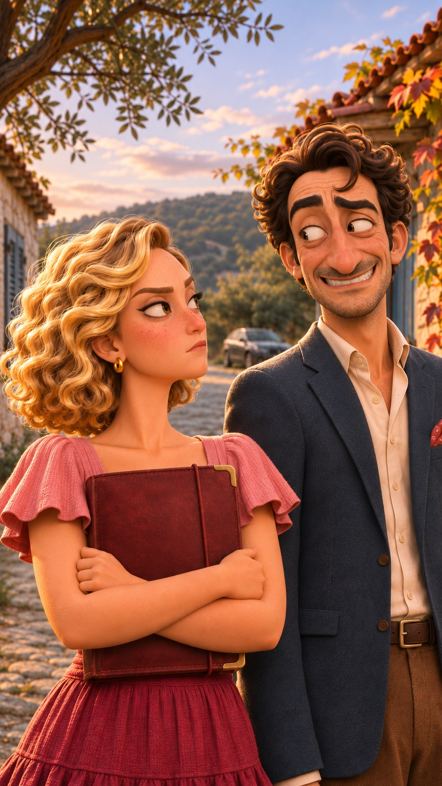

Prompt:

```
Stylized 3D animated feature film look, single continuous shot. Camera is locked off for the whole shot: no pan, no zoom, no cut. Duration 6 seconds.

Start exactly from the first frame: chest-up two-shot, Selin on the left hugging the burgundy folder and looking hard at Rıza; Rıza on the right, facing forward, eyes sliding toward her, nervous smile.

Hands and objects (do not change):
- Selin keeps BOTH arms crossed over the burgundy folder against her chest for the entire shot. She makes no hand gestures. The folder never moves and keeps the same size.
- Rıza's arms stay down, out of frame. He makes no gestures.

Voices (must sound exactly the same in every clip of this series):
- Selin: Turkish woman in her early thirties. Calm, warm, slightly husky low voice. Dry, deadpan humor, never loud.
- Rıza: Turkish man in his mid thirties. Warm, bright, slightly nasal tenor. Talks fast, easily excited, salesman energy.

Every character is a native Turkish speaker. They speak ONLY Turkish, with a natural Istanbul accent and the lively, expressive delivery of actors in a Turkish animated comedy film. No English.

0-0.5 s: Selin stares at Rıza.
0.5-2 s: Selin asks in Turkish, quiet and precise: "Kimin parasıyla?"
2-5.5 s: Rıza looks away from her, clears nothing, and answers in Turkish, light at first and slower after the pause: "Dedemden kalan… biraz da birikim."
5.5-6 s: Nobody speaks. Selin does not blink.

Last frame: both stand exactly where they started; Selin still looking at Rıza, Rıza looking down and away.

Eyes: Selin looks only at Rıza's face. Rıza looks down and away from her. Nobody looks at the camera. Faces, hair and clothes stay identical to the first frame.

Pronunciation: the name "Rıza" contains the Turkish dotless ı. Say it "RUH-zah", never "Riza" or "Reeza".

Only the speaking character's mouth moves. Audio: the voices and light wind only. No music, no subtitles, no on-screen text.
```

## P06b

**Başlangıç karesi:** P06a'nın son karesi · **Süre:** 6 sn

Kare henüz hazır değil.

Prompt:

```
Stylized 3D animated feature film look, single continuous shot. Camera is locked off for the whole shot: no pan, no zoom, no cut. Duration 6 seconds.

Start exactly from the first frame: chest-up two-shot, Selin on the left hugging the burgundy folder and looking at Rıza; Rıza on the right, looking down and away.

Hands and objects (do not change):
- Selin keeps BOTH arms crossed over the burgundy folder against her chest for the entire shot. She makes no hand gestures. The folder never moves and keeps the same size.
- Rıza's arms stay down, out of frame. He makes no gestures.

Voices (must sound exactly the same in every clip of this series):
- Selin: Turkish woman in her early thirties. Calm, warm, slightly husky low voice. Dry, deadpan humor, never loud.
- Rıza: Turkish man in his mid thirties. Warm, bright, slightly nasal tenor. Talks fast, easily excited, salesman energy.

Every character is a native Turkish speaker. They speak ONLY Turkish, with a natural Istanbul accent and the lively, expressive delivery of actors in a Turkish animated comedy film. No English.

0-1.5 s: Selin, still looking at him, asks in Turkish, even quieter: "Biraz dediğin?"
1.5-2.5 s: Rıza swallows. His shoulders rise a little.
2.5-5 s: Rıza answers in Turkish, his voice dropping lower with every word until it is almost a mumble: "Ev için ayırdığımız kadar."
5-6 s: Nobody speaks. Selin's face does not move at all.

Last frame: both stand exactly where they started; Selin staring at Rıza, Rıza shrunk into his shoulders, looking at the ground.

Eyes: Selin looks only at Rıza's face. Rıza looks at the ground. Nobody looks at the camera. Faces, hair and clothes stay identical to the first frame.

Pronunciation: the name "Rıza" contains the Turkish dotless ı. Say it "RUH-zah", never "Riza" or "Reeza".

Only the speaking character's mouth moves. Audio: the voices and light wind only. No music, no subtitles, no on-screen text.
```

## P07

**Başlangıç karesi:** SB01 · **Süre:** 4 sn

Dosya: `klipler/P07/P07_baslangic_karesi_SB01.jpg`


Prompt:

```
Stylized 3D animated feature film look, single continuous shot. Camera is locked off for the whole shot: no pan, no zoom, no cut. Duration 4 seconds.

Start exactly from the first frame: waist-up shot of Selin alone, slightly left of center, hugging a burgundy folder against her chest with both arms, frozen, staring at something far ahead past the right edge of the frame. A light breeze moves her curls.

Hands and objects (do not change):
- Selin keeps BOTH arms crossed over the burgundy folder against her chest for the entire shot. She makes no hand gestures. The folder never moves and keeps the same size.

0-2 s: Selin does not move and does not blink. Only her curls move in the breeze.
2-2.5 s: Her LEFT eyelid twitches once, small and sharp. Nothing else in her face moves.
2.5-4 s: She stays frozen. A goat bleats once, off screen, far away.

Last frame: the same shot, Selin in the same place, still frozen, mouth closed, arms still crossed over the folder.

Eyes: Selin looks only at the far point ahead, past the right edge of the frame. Nobody looks at the camera. Faces, hair and clothes stay identical to the first frame.

No dialogue. Nobody speaks. Audio: light wind and one distant goat bleat only. No music, no subtitles, no on-screen text.
```

## P08

**Başlangıç karesi:** SB08 · **Süre:** 6 sn

Dosya: `klipler/P08/P08_baslangic_karesi_SB08.jpg`

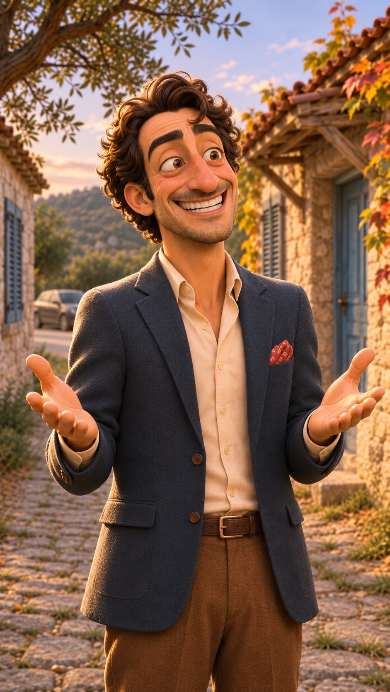

Prompt:

```
Stylized 3D animated feature film look, single continuous shot. Camera is locked off for the whole shot: no pan, no zoom, no cut. Duration 6 seconds.

Start exactly from the first frame: waist-up shot of Rıza alone, both palms open at chest height, a wide forced smile, looking past the camera at the village.

Hands and objects (do not change):
- Rıza gestures only with his LEFT arm (on the right side of the frame). His right hand lowers to his side at the start and stays there.

Voices (must sound exactly the same in every clip of this series):
- Rıza: Turkish man in his mid thirties. Warm, bright, slightly nasal tenor. Talks fast, easily excited, salesman energy.

Every character is a native Turkish speaker. They speak ONLY Turkish, with a natural Istanbul accent and the lively, expressive delivery of actors in a Turkish animated comedy film. No English.

0-1 s: Rıza takes a quick breath and pulls his smile wider.
1-4 s: He sweeps his LEFT arm toward the right of the frame, pointing at one spot and then another, and says in Turkish, fast, in full salesman mode: "Ama potansiyele bak! Şuraya kafe, şuraya ortak çalışma alanı—"
4 s: A loud metal CLANG and a heavy thud come from off screen on the right. He stops in the middle of the word.
4-6 s: Rıza freezes: arm still in the air, smile stuck on his face. Only his eyes slide slowly toward the sound.

Last frame: Rıza frozen in place, arm raised, smile stuck, eyes turned toward the right edge of the frame.

Eyes: Rıza looks past the camera at the village, then toward the right edge of the frame. Nobody looks at the camera. Faces, hair and clothes stay identical to the first frame.

Pronunciation: the name "Rıza" contains the Turkish dotless ı. Say it "RUH-zah", never "Riza" or "Reeza". "potansiyele" sounds like "po-tan-see-yeh-LEH". "çalışma" sounds like "cha-lush-MAH".

Only the speaking character's mouth moves. Audio: the voices and light wind, then one loud metal clang with a heavy thud at 4 seconds only. No music, no subtitles, no on-screen text.
```

## P09

**Başlangıç karesi:** SB09 · **Süre:** 4 sn

Dosya: `klipler/P09/P09_baslangic_karesi_SB09.jpg`

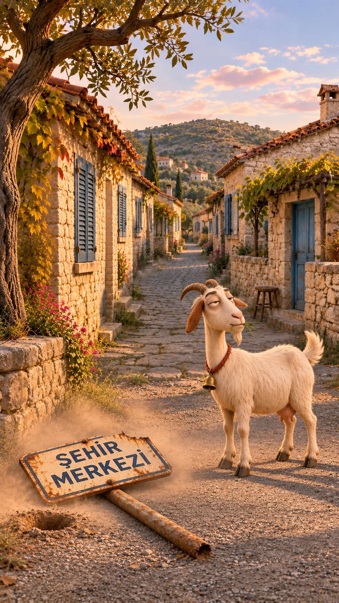

Prompt:

```
Stylized 3D animated feature film look, single continuous shot. Camera is locked off for the whole shot: no pan, no zoom, no cut. Duration 4 seconds.

Start exactly from the first frame: wide shot of the village entrance; the road sign lies flat on the gravel in a low cloud of dust, the goat stands beside it chewing.

Hands and objects (do not change):
- The sign lies flat on the ground and does not move. Its text stays exactly "ŞEHİR MERKEZİ".
- The goat takes at most one slow step.

0-4 s: The dust cloud drifts and slowly thins. The goat keeps chewing, takes one unhurried step away from the sign, and stops. Its bell tinkles once. It never looks at the sign.

Last frame: the sign flat on the ground, the dust nearly settled, the goat standing one step further right, chewing.

Eyes: The goat looks away from the sign. Nobody looks at the camera. Faces, hair and clothes stay identical to the first frame.

No dialogue. Nobody speaks. Audio: light wind, soft chewing, one bell tinkle only. No music, no subtitles, no on-screen text.
```

## P10

**Başlangıç karesi:** SB10 · **Süre:** 6 sn

Dosya: `klipler/P10/P10_baslangic_karesi_SB10.jpg`


Prompt:

```
Stylized 3D animated feature film look, single continuous shot. Camera is locked off for the whole shot: no pan, no zoom, no cut. Duration 6 seconds.

Start exactly from the first frame: knees-up shot of Naci sitting on a wooden stool against a stone wall, a small tea glass in his right hand, a thick yellow envelope lying on the stone shelf beside him; he looks toward people off screen on the right.

Hands and objects (do not change):
- Naci's RIGHT hand holds the tea glass for the entire shot. The glass keeps the same size.
- His LEFT hand stays flat on his left knee and does not move.
- The yellow envelope stays untouched on the stone shelf.
- He stays seated.

Voices (must sound exactly the same in every clip of this series):
- Naci: Turkish man in his late sixties. Slow, dry, gravelly low voice. Never in a hurry, faintly amused.

Every character is a native Turkish speaker. They speak ONLY Turkish, with a natural Istanbul accent and the lively, expressive delivery of actors in a Turkish animated comedy film. No English.

0-2 s: Naci asks in Turkish, slow and unbothered: "Yeni sahipler siz misiniz?"
2-3.5 s: He lifts the glass and takes one slow sip, eyes still on them.
3.5-5.5 s: He lowers the glass and says in Turkish, dry, as a simple observation: "Öncekiler de böyle heyecanlıydı."
5.5-6 s: A very small smile under his moustache.

Last frame: Naci seated exactly as at the start, glass at chest height, left hand on his knee, envelope on the shelf.

Eyes: Naci looks only toward the right edge of the frame. Nobody looks at the camera. Faces, hair and clothes stay identical to the first frame.

Pronunciation: the name "Rıza" contains the Turkish dotless ı. Say it "RUH-zah", never "Riza" or "Reeza". "heyecanlıydı" sounds like "heh-yeh-jan-LUY-duh".

Only the speaking character's mouth moves. Audio: the voices and light wind, one faint clink of glass only. No music, no subtitles, no on-screen text.
```

## P11

**Başlangıç karesi:** SB11 · **Süre:** 4 sn

Dosya: `klipler/P11/P11_baslangic_karesi_SB11.jpg`

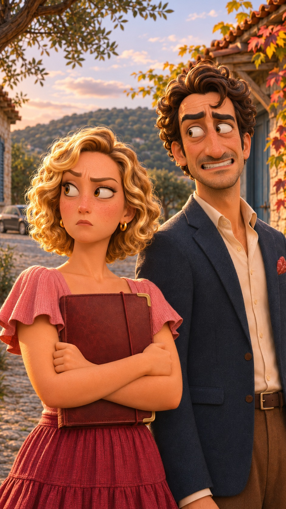

Prompt:

```
Stylized 3D animated feature film look, single continuous shot. Camera is locked off for the whole shot: no pan, no zoom, no cut. Duration 4 seconds.

Start exactly from the first frame: chest-up two-shot, Selin on the left hugging the burgundy folder, Rıza on the right; both look at someone off screen on the left.

Hands and objects (do not change):
- Selin keeps BOTH arms crossed over the burgundy folder against her chest for the entire shot. She makes no hand gestures. The folder never moves and keeps the same size.
- Rıza's arms stay down, out of frame. He makes no gestures.

Voices (must sound exactly the same in every clip of this series):
- Selin: Turkish woman in her early thirties. Calm, warm, slightly husky low voice. Dry, deadpan humor, never loud.

Every character is a native Turkish speaker. They speak ONLY Turkish, with a natural Istanbul accent and the lively, expressive delivery of actors in a Turkish animated comedy film. No English.

0-1 s: Both stare toward the left. Selin's eyebrow rises.
1-2.5 s: Selin asks in Turkish, sharp and quiet: "Öncekiler mi?"
2.5-4 s: Nobody speaks. Rıza's stiff smile twitches at one corner. He does not say anything.

Last frame: both stand exactly where they started, still looking off screen to the left.

Eyes: Selin and Rıza look only toward the left edge of the frame. Nobody looks at the camera. Faces, hair and clothes stay identical to the first frame.

Pronunciation: the name "Rıza" contains the Turkish dotless ı. Say it "RUH-zah", never "Riza" or "Reeza". "Öncekiler" sounds like "urn-jeh-kee-LEHR".

Only the speaking character's mouth moves. Audio: the voices and light wind only. No music, no subtitles, no on-screen text.
```

## P12

**Başlangıç karesi:** SB12 · **Süre:** 4 sn

Dosya: `klipler/P12/P12_baslangic_karesi_SB12.jpg`

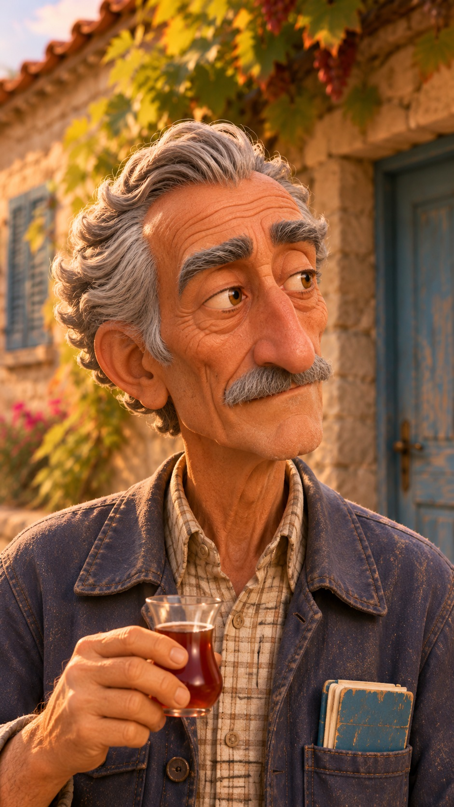

Prompt:

```
Stylized 3D animated feature film look, single continuous shot. Camera is locked off for the whole shot: no pan, no zoom, no cut. Duration 4 seconds.

Start exactly from the first frame: close-up of Naci, the tea glass just below his chin in his right hand, a flat unreadable face, looking toward people off screen on the right.

Hands and objects (do not change):
- Naci's RIGHT hand holds the tea glass just below his chin for the entire shot. He does not drink.

Voices (must sound exactly the same in every clip of this series):
- Naci: Turkish man in his late sixties. Slow, dry, gravelly low voice. Never in a hurry, faintly amused.

Every character is a native Turkish speaker. They speak ONLY Turkish, with a natural Istanbul accent and the lively, expressive delivery of actors in a Turkish animated comedy film. No English.

0-1 s: Naci looks at them, unhurried.
1-3 s: He says in Turkish, flat, a plain fact: "Üç gün dayandılar."
3-4 s: One slow blink. His face does not change.

Last frame: the same close-up, Naci unmoved, glass in the same place.

Eyes: Naci looks only toward the right edge of the frame. Nobody looks at the camera. Faces, hair and clothes stay identical to the first frame.

Pronunciation: the name "Rıza" contains the Turkish dotless ı. Say it "RUH-zah", never "Riza" or "Reeza". "üç" sounds like "ewch". "gün" sounds like "gewn". "dayandılar" sounds like "da-yan-duh-LAR".

Only the speaking character's mouth moves. Audio: the voices and light wind only. No music, no subtitles, no on-screen text.
```

## P13

**Başlangıç karesi:** SB10 · **Süre:** 6 sn

Dosya: `klipler/P13/P13_baslangic_karesi_SB10.jpg`

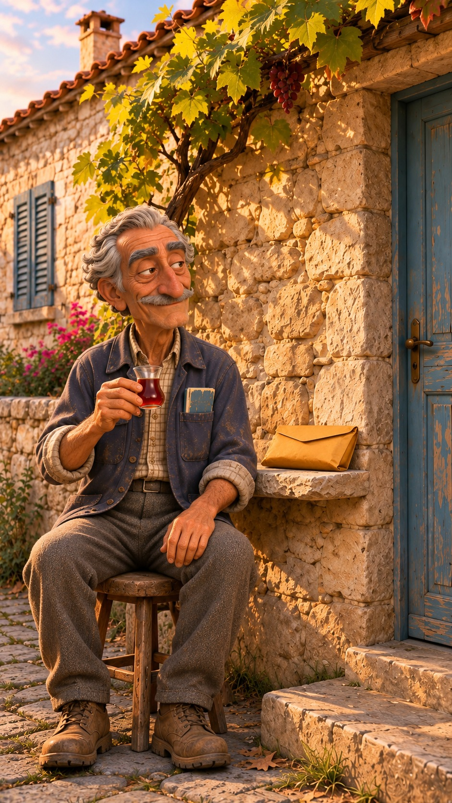

Prompt:

```
Stylized 3D animated feature film look, single continuous shot. Camera is locked off for the whole shot: no pan, no zoom, no cut. Duration 6 seconds.

Start exactly from the first frame: knees-up shot of Naci sitting on a wooden stool against a stone wall, a small tea glass in his right hand, a thick yellow envelope lying on the stone shelf beside him; he looks toward people off screen on the right.

Hands and objects (do not change):
- Naci's RIGHT hand holds the tea glass at chest height for the entire shot. He does not drink.
- His LEFT hand lifts from his knee, picks up the yellow envelope from the stone shelf and holds it out toward the right edge of the frame at arm's length. The envelope keeps the same size and stays closed.
- He stays seated.

Voices (must sound exactly the same in every clip of this series):
- Naci: Turkish man in his late sixties. Slow, dry, gravelly low voice. Never in a hurry, faintly amused.

Every character is a native Turkish speaker. They speak ONLY Turkish, with a natural Istanbul accent and the lively, expressive delivery of actors in a Turkish animated comedy film. No English.

0-2.5 s: Naci says in Turkish, as if he has just remembered something small: "Bu arada… köyün elektrik borcu." While he speaks, his LEFT hand picks up the yellow envelope from the stone shelf.
2.5-4 s: He holds the envelope out toward the right edge of the frame, arm straight, without getting up.
4-5.5 s: He says in Turkish, casual, almost kind: "Artık sizin."
5.5-6 s: He keeps the envelope held out. His face does not change.

Last frame: Naci seated, tea glass in his right hand, left arm stretched out holding the envelope toward the right edge of the frame.

Eyes: Naci looks only toward the right edge of the frame. Nobody looks at the camera. Faces, hair and clothes stay identical to the first frame.

Pronunciation: the name "Rıza" contains the Turkish dotless ı. Say it "RUH-zah", never "Riza" or "Reeza". "köyün" sounds like "kur-YEWN". "borcu" sounds like "bor-JOO". "artık" sounds like "ar-TUK".

Only the speaking character's mouth moves. Audio: the voices and light wind, a soft rustle of paper only. No music, no subtitles, no on-screen text.
```

## P14

**Başlangıç karesi:** SB14 · **Süre:** 6 sn

Dosya: `klipler/P14/P14_baslangic_karesi_SB14.jpg`

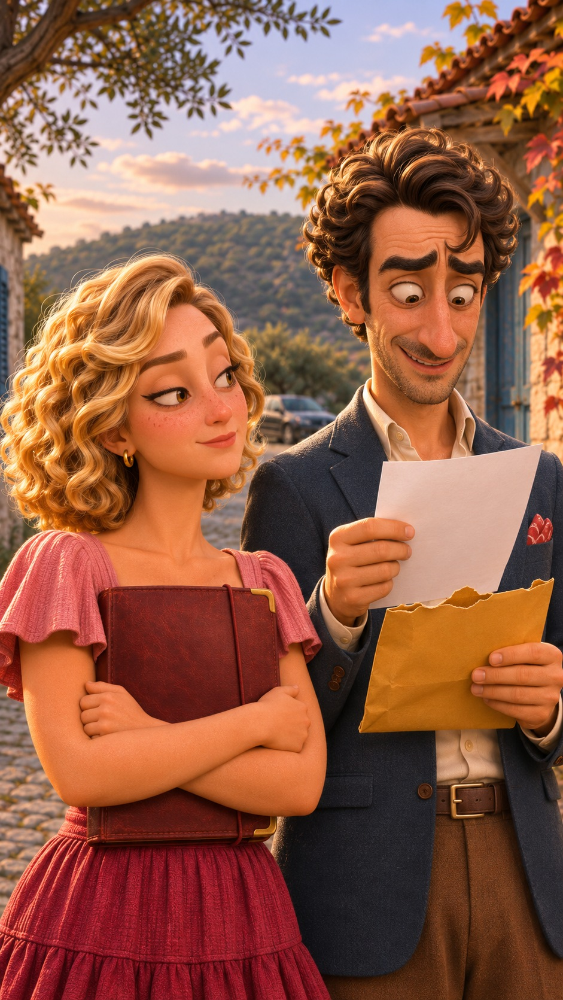

Prompt:

```
Stylized 3D animated feature film look, single continuous shot. Camera is locked off for the whole shot: no pan, no zoom, no cut. Duration 6 seconds.

Start exactly from the first frame: chest-up two-shot, Rıza on the right holding a torn-open yellow envelope in his left hand and a single white sheet in his right hand, reading it; Selin on the left hugging the burgundy folder, watching his face.

Hands and objects (do not change):
- Selin keeps BOTH arms crossed over the burgundy folder against her chest for the entire shot. She makes no hand gestures. The folder never moves and keeps the same size.
- Rıza's LEFT hand holds the envelope and his RIGHT hand holds the sheet at chest height for the entire shot. He does not lower them, turn the sheet or gesture. The camera only ever sees the blank back of the sheet.

Voices (must sound exactly the same in every clip of this series):
- Selin: Turkish woman in her early thirties. Calm, warm, slightly husky low voice. Dry, deadpan humor, never loud.

Every character is a native Turkish speaker. They speak ONLY Turkish, with a natural Istanbul accent and the lively, expressive delivery of actors in a Turkish animated comedy film. No English.

0-2 s: Rıza's eyes move down the sheet. The last of his smile disappears. His eyebrows climb.
2-3.5 s: Selin, watching his face, says in Turkish, calm and very quiet, two separate words: "Rıza. Kaç?"
3.5-5 s: Rıza swallows hard. He opens his mouth slightly, closes it again and says nothing. His eyes stay on the sheet.
5-6 s: Nobody moves. Selin keeps looking at him.

Last frame: both stand exactly where they started; Rıza staring at the sheet, pale, mouth closed; Selin watching him.

Eyes: Rıza looks only at the sheet. Selin looks only at Rıza's face. Nobody looks at the camera. Faces, hair and clothes stay identical to the first frame.

Pronunciation: the name "Rıza" contains the Turkish dotless ı. Say it "RUH-zah", never "Riza" or "Reeza". "Kaç" sounds like "kach".

Only the speaking character's mouth moves. Audio: the voices and light wind only. No music, no subtitles, no on-screen text.
```
