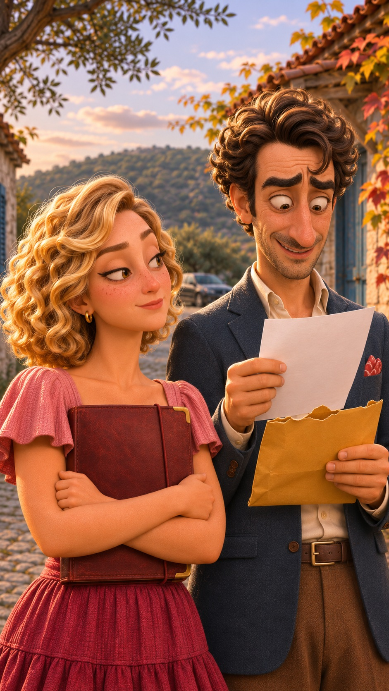
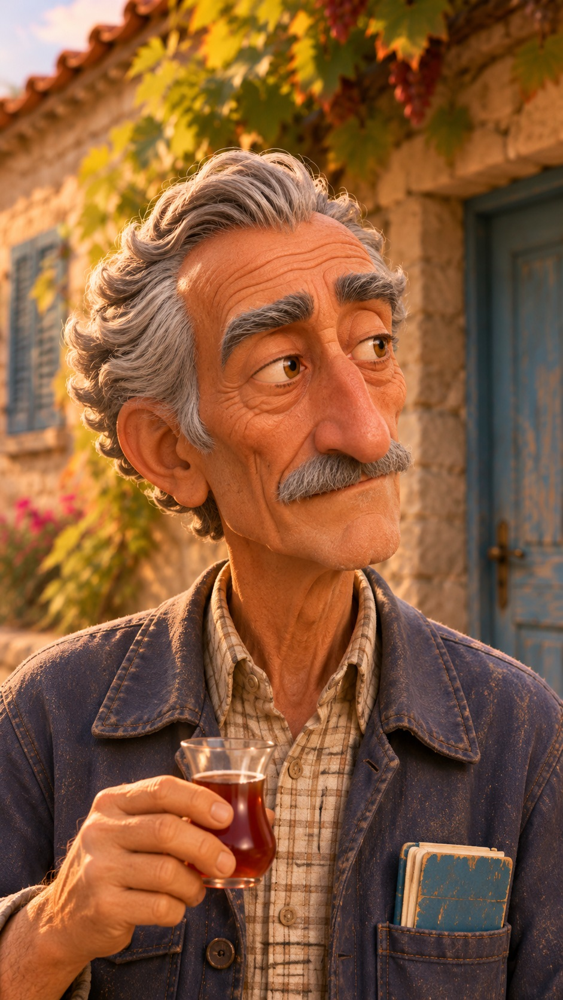
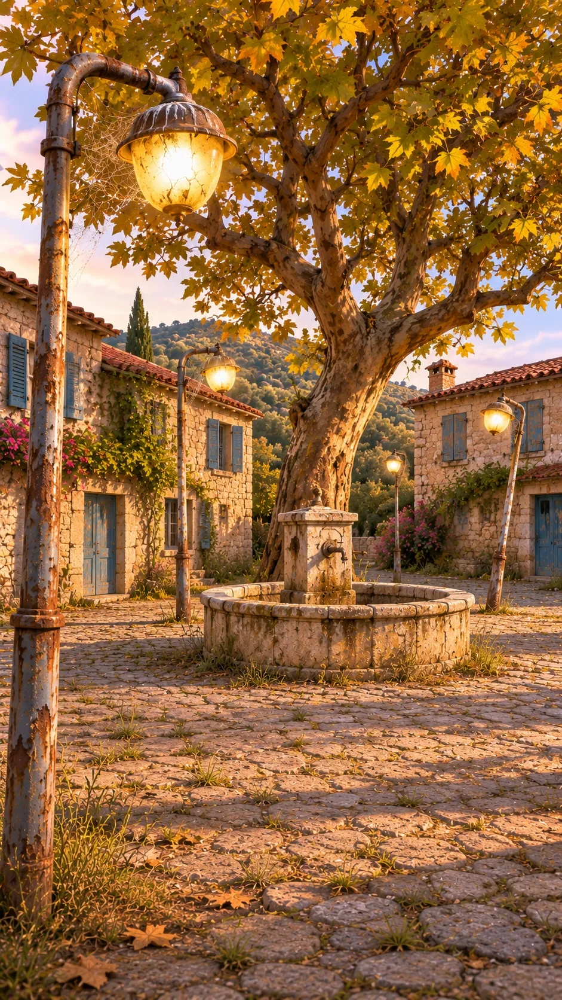
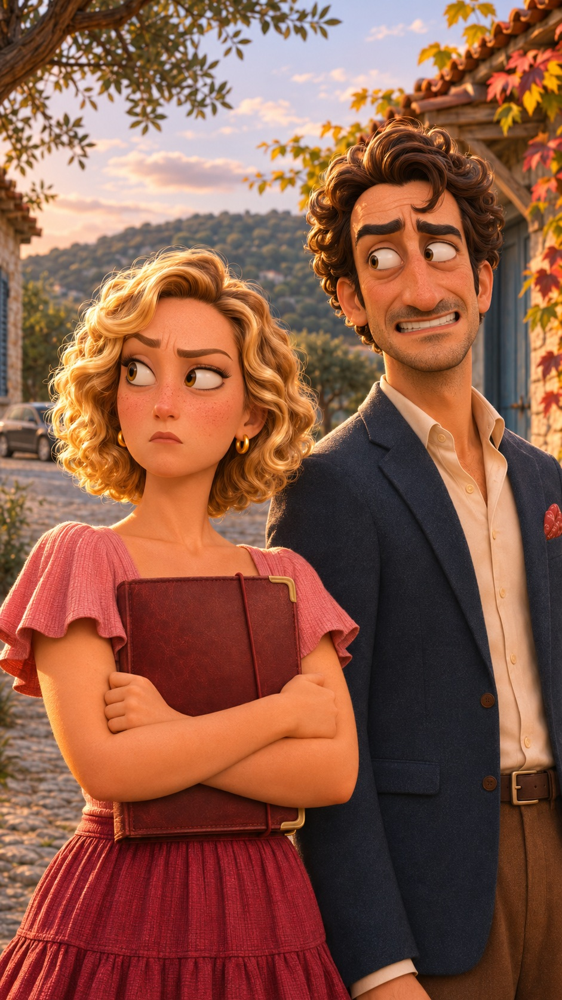
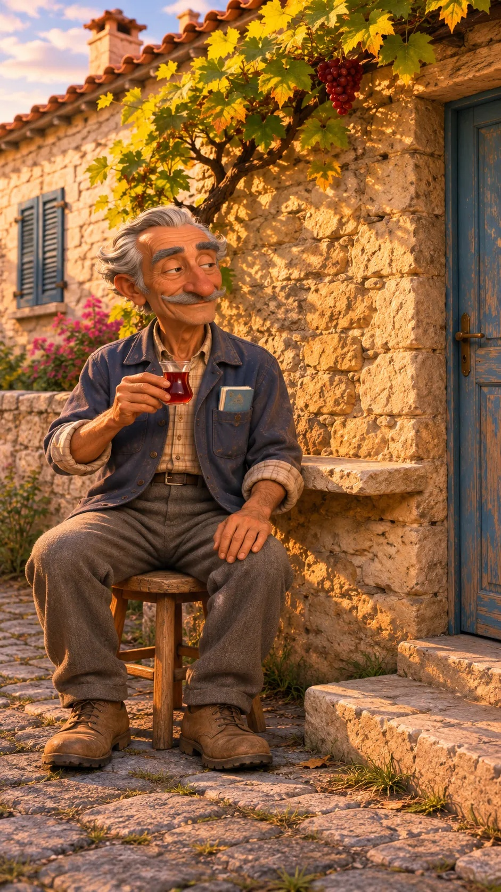
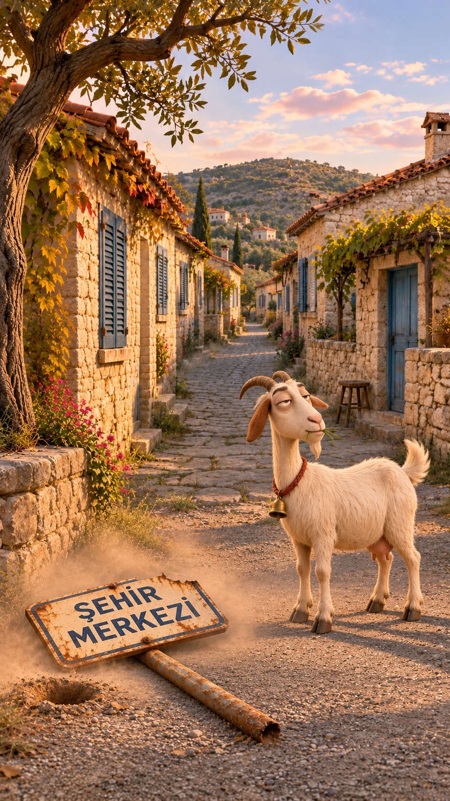
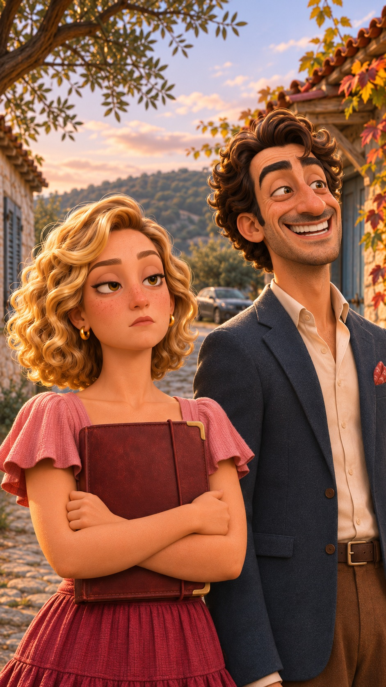
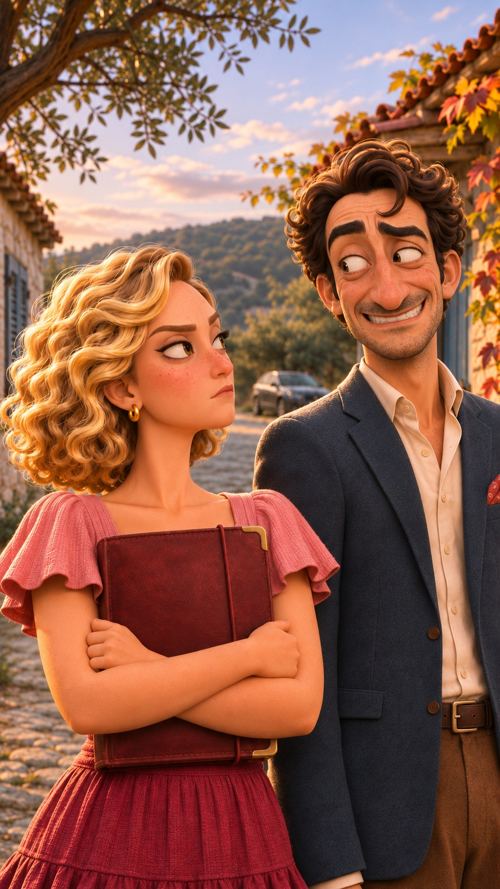

# B02 üretim paketi

Bu dosya `araclar/b02_paket.py` tarafından üretilir; elle düzenleme, betiği düzenle.

## 1. Yeni kareler (yalnızca 2 tane; görsel üretimi, 9:16)

Her karenin klasöründe (`kareler/SBxx/`) numaralı referanslar ve prompt var: klasördeki görselleri ekle, promptu yapıştır. Çıkan kareyi `kareler/onayli/SBxx.jpg` olarak koy (ya da sohbete yükle); kontrol etmeden videosu üretilmez.

| Kare | Ne | Referanslar | Hangi klipte |
|---|---|---|---|
| SB21 | Naci taburede, orta plan, zarf yok | SB10 (B01 onaylı kare); Naci sayfası; Naci ifade sayfası | P05, P10 |
| SB20 | Köy meydanı (yeni mekân), gündüz yanan sokak lambaları |  | P06 |

Diğer 12 klip B01'in onaylı karelerinden (SB03, SB06, SB09, SB11, SB12, SB14) başlar; yeniden üretilmez.

## 2. Klipler

Flow ayarı her klip için aynı: **kareden videoya · Veo 3.1 Lite · 9:16**. Başlangıç karesi olarak yalnızca klasördeki kareyi yükle. Çıkan mp4: `klipler/gelen/Pxx.mp4`.

| Klip | Ne | Başlangıç karesi | Süre | Replikler | Kare |
|---|---|---|---|---|---|
| P01 | Kaç? | SB14 | 6 sn | SELİN: "Rıza. Kaç para?" / RIZA: "Üç…" / SELİN: "Üç bin mi?" | Hazır |
| P02 | Üç yüz otuz üç bin | P01'in son karesi | 6 sn | RIZA: "Üç yüz otuz üç bin… üç yüz otuz üç lira, hayatım." | Bekleniyor |
| P03 | Otuz üç kuruş | SB12 | 4 sn | NACİ: "Otuz üç de kuruşu var." | Hazır |
| P04 | Kim yaktı | SB11 | 6 sn | SELİN: "Amca, burada üç kişi yaşıyorsunuz. Bu kadar elektriği kim yaktı ya?" | Hazır |
| P05 | Sokak lambaları | SB21 | 6 sn | NACİ: "Meydandaki lambalar." / "On iki senedir yanıyor. Gerisi faiz." | Hazır |
| P06 | Lambalar | SB20 | 4 sn | — | Hazır |
| P07 | Şalter nerede | SB11 | 6 sn | RIZA: "Ya tamam, sorun yok! Kapatırız, biter. Şalter nerede amca?" | Hazır |
| P08 | Muhtarda | SB12 | 4 sn | NACİ: "Muhtarda." | Hazır |
| P09 | Toplantı | SB11 | 6 sn | RIZA: "Süper! Hemen bir toplantı ayarlayalım muhtarla." | Hazır |
| P10 | Orada | SB21 | 4 sn | NACİ: "Kendisi şurada." | Hazır |
| P11 | Muhtar | SB09 | 4 sn | — | Hazır |
| P12 | Demokratik süreç | SB03 | 6 sn | SELİN: "Rıza… bu muhtar keçi." / RIZA: "Demokratik bir süreç olmuştur aşkım." | Hazır |
| P13 | Üç oy | SB12 | 4 sn | NACİ: "Üç oyla seçildi." | Hazır |
| P14 | Git konuş | SB06 | 6 sn | SELİN: "Hadi git konuş." / RIZA: "Keçiyle mi ya?" / SELİN: "Muhtarla, hayatım." | Hazır |
| **Toplam** | | | **72 sn** | | |

Notlar:
- P02, P01 klibinin son karesinden başlar (P01 gelince çıkarılır).
- P05 ve P10, yeni SB21 karesini; P06, yeni SB20 karesini bekler.
- SB11 üç klipte (P04, P07, P09), SB12 üç klipte (P03, P08, P13) başlangıç karesidir; aralarında karşı açı olduğu için kurguda sıçrama görünmez.
- Ekran yazıları kurguda eklenir; kliplerde yazı istenmez.

## 3. Promptlar

### P01 — Kaç?

**Başlangıç karesi:** SB14 · **Süre:** 6 sn



```
Stylized 3D animated feature film look, single continuous shot. Camera is locked off for the whole shot: no pan, no zoom, no cut. Duration 6 seconds.

Start exactly from the first frame: chest-up two-shot, Selin on the left hugging a burgundy folder and watching Rıza's face; Rıza on the right holding an open yellow envelope and a white sheet of paper, eyes lowered to the sheet.

Hands and objects (do not change):
- Selin keeps BOTH arms crossed over the burgundy folder against her chest for the entire shot. She makes no hand gestures. The folder never moves and keeps the same size.
- Rıza's LEFT hand holds the torn-open mustard-yellow envelope at chest height and his RIGHT hand holds the single white sheet just above it, for the entire shot. The sheet's blank back faces the camera; no text is ever visible. He does not gesture, does not lower or drop them.

Voices (must sound exactly the same in every clip of this series):
- Selin: Turkish woman in her early thirties. Calm, warm, slightly husky low voice. Dry, deadpan humor, never loud.
- Rıza: Turkish man in his mid thirties. Warm, bright, slightly nasal tenor. Talks fast, easily excited, salesman energy.

Every character is a native Turkish speaker. They speak ONLY Turkish, with a natural Istanbul accent and the lively, expressive delivery of actors in a Turkish animated comedy film. No English.

0-1.5 s: Selin, watching Rıza's face, says in Turkish, calm and quiet: "Rıza. Kaç para?"
1.5-3 s: Rıza swallows hard, eyes still on the sheet, and says in Turkish, in a small voice that trails off: "Üç…"
3-4.5 s: Selin answers in Turkish, with a little careful hope: "Üç bin mi?"
4.5-6 s: Nobody speaks. Rıza slowly shakes his head, very slightly, without looking up. Selin's face goes flat.

Last frame: both stand exactly where they started, nobody walks; Rıza still looking down at the sheet, Selin still looking at Rıza, both mouths closed.

Eyes: Rıza looks only at the sheet. Selin looks only at Rıza's face. Nobody looks at the camera. Faces, hair and clothes stay identical to the first frame.

Pronunciation: the name "Rıza" contains the Turkish dotless ı. Say it "RUH-zah", never "Riza" or "Reeza". "üç" is one short syllable, like "ewch".

Only the speaking character's mouth moves. Audio: the voices and light wind only. No music, no subtitles, no on-screen text.
```

### P02 — Üç yüz otuz üç bin

**Başlangıç karesi:** P01'in son karesi · **Süre:** 6 sn

Kare henüz hazır değil.

```
Stylized 3D animated feature film look, single continuous shot. Camera is locked off for the whole shot: no pan, no zoom, no cut. Duration 6 seconds.

Start exactly from the first frame: chest-up two-shot, Selin on the left hugging a burgundy folder and watching Rıza's face; Rıza on the right holding an open yellow envelope and a white sheet of paper, eyes lowered to the sheet.

Hands and objects (do not change):
- Selin keeps BOTH arms crossed over the burgundy folder against her chest for the entire shot. She makes no hand gestures. The folder never moves and keeps the same size.
- Rıza's LEFT hand holds the torn-open mustard-yellow envelope at chest height and his RIGHT hand holds the single white sheet just above it, for the entire shot. The sheet's blank back faces the camera; no text is ever visible. He does not gesture, does not lower or drop them.

Voices (must sound exactly the same in every clip of this series):
- Rıza: Turkish man in his mid thirties. Warm, bright, slightly nasal tenor. Talks fast, easily excited, salesman energy.

Every character is a native Turkish speaker. They speak ONLY Turkish, with a natural Istanbul accent and the lively, expressive delivery of actors in a Turkish animated comedy film. No English.

0-5 s: Rıza reads from the sheet in Turkish, slowly, his voice getting smaller with every word, with a pause in the middle: "Üç yüz otuz üç bin… üç yüz otuz üç lira, hayatım."
5-6 s: Nobody speaks. Selin closes her eyes and breathes out slowly through her nose. Rıza stays bent over the sheet, not daring to look at her.

Last frame: both stand exactly where they started, nobody walks; Selin's eyes closed, Rıza looking down at the sheet, both mouths closed.

Eyes: Rıza looks only at the sheet. Selin looks at Rıza, then closes her eyes. Nobody looks at the camera. Faces, hair and clothes stay identical to the first frame.

Pronunciation: the name "Rıza" contains the Turkish dotless ı. Say it "RUH-zah", never "Riza" or "Reeza". The number is read as six clear words, then a pause, then five words and a meek little "hayatım" (my dear) at the end: "üç yüz otuz üç bin" (333 thousand), "üç yüz otuz üç lira" (333 lira). "üç" sounds like "ewch", "yüz" like "yewz", "otuz" like "oh-TOOZ".

Only the speaking character's mouth moves. Audio: the voices and light wind only. No music, no subtitles, no on-screen text.
```

### P03 — Otuz üç kuruş

**Başlangıç karesi:** SB12 · **Süre:** 4 sn



```
Stylized 3D animated feature film look, single continuous shot. Camera is locked off for the whole shot: no pan, no zoom, no cut. Duration 4 seconds.

Start exactly from the first frame: close-up of Naci, head and shoulders, tea glass held just below his chin, looking toward the right edge of the frame.

Hands and objects (do not change):
- Naci's RIGHT hand holds the small tea glass for the entire shot; the glass never leaves his hand and stays the same size. His other hand is not in the frame.

Voices (must sound exactly the same in every clip of this series):
- Naci: Turkish man in his late sixties. Slow, dry, gravelly low voice. Never in a hurry, faintly amused.

Every character is a native Turkish speaker. They speak ONLY Turkish, with a natural Istanbul accent and the lively, expressive delivery of actors in a Turkish animated comedy film. No English.

0-0.5 s: Naci looks toward the right edge of the frame, face flat.
0.5-2.5 s: He adds in Turkish, dry and helpful, as if correcting a small detail: "Otuz üç de kuruşu var."
2.5-4 s: He does not speak. He raises the glass to his lips and takes one small sip, eyes half closed.

Last frame: Naci in the same place, glass at his lips, mouth closed on the glass.

Eyes: Naci looks toward the right edge of the frame, at people off screen. Nobody looks at the camera. Faces, hair and clothes stay identical to the first frame.

Pronunciation: the name "Rıza" contains the Turkish dotless ı. Say it "RUH-zah", never "Riza" or "Reeza". "kuruş" sounds like "koo-ROOSH".

Only the speaking character's mouth moves. Audio: the voices and light wind and one soft sip only. No music, no subtitles, no on-screen text.
```

### P04 — Kim yaktı

**Başlangıç karesi:** SB11 · **Süre:** 6 sn


```
Stylized 3D animated feature film look, single continuous shot. Camera is locked off for the whole shot: no pan, no zoom, no cut. Duration 6 seconds.

Start exactly from the first frame: chest-up two-shot, Selin on the left hugging a burgundy folder, Rıza on the right with a stiff smile; both have their heads turned toward the left edge of the frame, looking at someone off screen.

Hands and objects (do not change):
- Selin keeps BOTH arms crossed over the burgundy folder against her chest for the entire shot. She makes no hand gestures. The folder never moves and keeps the same size.
- Rıza's arms stay down, out of frame, for the entire shot. He makes no hand gestures.

Voices (must sound exactly the same in every clip of this series):
- Selin: Turkish woman in her early thirties. Calm, warm, slightly husky low voice. Dry, deadpan humor, never loud.

Every character is a native Turkish speaker. They speak ONLY Turkish, with a natural Istanbul accent and the lively, expressive delivery of actors in a Turkish animated comedy film. No English.

0-0.5 s: Both look toward the left edge of the frame.
0.5-5 s: Selin says in Turkish toward the person off screen on the left, calm, precise, like an auditor: "Amca, burada üç kişi yaşıyorsunuz. Bu kadar elektriği kim yaktı ya?"
5-6 s: Nobody speaks. Rıza nods twice, quickly, as if it had been his question too. Selin keeps looking left, waiting.

Last frame: both stand exactly where they started, nobody walks; both still looking toward the left edge of the frame, mouths closed.

Eyes: Selin and Rıza look only toward the left edge of the frame, at someone off screen. Rıza does not speak. Nobody looks at the camera. Faces, hair and clothes stay identical to the first frame.

Pronunciation: the name "Rıza" contains the Turkish dotless ı. Say it "RUH-zah", never "Riza" or "Reeza". "elektriği" sounds like "eh-lek-tree-EE".

Only the speaking character's mouth moves. Audio: the voices and light wind only. No music, no subtitles, no on-screen text.
```

### P05 — Sokak lambaları

**Başlangıç karesi:** SB21 · **Süre:** 6 sn


```
Stylized 3D animated feature film look, single continuous shot. Camera is locked off for the whole shot: no pan, no zoom, no cut. Duration 6 seconds.

Start exactly from the first frame: medium shot of Naci sitting on a wooden stool against a stone wall, tea glass in his right hand at chest height, left hand on his knee, the stone shelf beside him empty.

Hands and objects (do not change):
- Naci's RIGHT hand holds the small tea glass for the entire shot; the glass never leaves his hand and stays the same size.
- His LEFT hand stays flat on his left knee for the entire shot. He makes no hand gestures. The stone shelf stays empty.

Voices (must sound exactly the same in every clip of this series):
- Naci: Turkish man in his late sixties. Slow, dry, gravelly low voice. Never in a hurry, faintly amused.

Every character is a native Turkish speaker. They speak ONLY Turkish, with a natural Istanbul accent and the lively, expressive delivery of actors in a Turkish animated comedy film. No English.

0-0.5 s: Naci looks toward the right edge of the frame, relaxed.
0.5-2 s: He says in Turkish, unhurried: "Meydandaki lambalar."
2-3 s: He does not speak. He glances up at the sky for a moment, then back.
3-5.5 s: He adds in Turkish, as plain fact, with a short pause between the two sentences: "On iki senedir yanıyor. Gerisi faiz."
5.5-6 s: He does not speak. A tiny shrug of one shoulder.

Last frame: Naci sitting exactly where he started, glass in his right hand at chest height, left hand on his knee, mouth closed.

Eyes: Naci looks toward the right edge of the frame, at people off screen. Nobody looks at the camera. Faces, hair and clothes stay identical to the first frame.

Pronunciation: the name "Rıza" contains the Turkish dotless ı. Say it "RUH-zah", never "Riza" or "Reeza". "senedir" sounds like "seh-neh-DEER". "Meydandaki" sounds like "may-dan-dah-KEE".

Only the speaking character's mouth moves. Audio: the voices and light wind only. No music, no subtitles, no on-screen text.
```

### P06 — Lambalar

**Başlangıç karesi:** SB20 · **Süre:** 4 sn



```
Stylized 3D animated feature film look, single continuous shot. Camera is locked off for the whole shot: no pan, no zoom, no cut. Duration 4 seconds.

Start exactly from the first frame: wide shot of an empty cobbled village square in golden daylight with a dry stone fountain, a plane tree and four shabby, rusty street lamps, all switched on.

Hands and objects (do not change):
- All four lamps stay lit for the whole shot and stay in the same place. Nothing enters the frame.

0-4 s: Nothing happens. The lamps glow uselessly in the sunshine. The nearest lamp flickers once and keeps burning. A few dry leaves drift across the square.

Last frame: the same square, all four lamps still lit.

Eyes: There are no people or animals in the shot. Nobody looks at the camera. Faces, hair and clothes stay identical to the first frame.

No dialogue. Nobody speaks. Audio: light wind and a faint electric hum from the lamps only. No music, no subtitles, no on-screen text.
```

### P07 — Şalter nerede

**Başlangıç karesi:** SB11 · **Süre:** 6 sn



```
Stylized 3D animated feature film look, single continuous shot. Camera is locked off for the whole shot: no pan, no zoom, no cut. Duration 6 seconds.

Start exactly from the first frame: chest-up two-shot, Selin on the left hugging a burgundy folder, Rıza on the right with a stiff smile; both have their heads turned toward the left edge of the frame, looking at someone off screen.

Hands and objects (do not change):
- Selin keeps BOTH arms crossed over the burgundy folder against her chest for the entire shot. She makes no hand gestures. The folder never moves and keeps the same size.
- Rıza's arms stay down, out of frame, for the entire shot. He makes no hand gestures.

Voices (must sound exactly the same in every clip of this series):
- Rıza: Turkish man in his mid thirties. Warm, bright, slightly nasal tenor. Talks fast, easily excited, salesman energy.

Every character is a native Turkish speaker. They speak ONLY Turkish, with a natural Istanbul accent and the lively, expressive delivery of actors in a Turkish animated comedy film. No English.

0-0.5 s: Both look toward the left edge of the frame. Rıza's stiff smile widens into a confident one.
0.5-4.5 s: Rıza says in Turkish toward the person off screen on the left, bright and fast, a man with a solution: "Ya tamam, sorun yok! Kapatırız, biter. Şalter nerede amca?"
4.5-6 s: Nobody speaks. Rıza keeps smiling left, eyebrows up, waiting. Selin's eyes slide sideways to Rıza for a moment, unimpressed, then back to the left.

Last frame: both stand exactly where they started, nobody walks; both looking toward the left edge of the frame, mouths closed.

Eyes: Rıza looks only toward the left edge of the frame. Selin looks left, glances at Rıza once, then left again. Selin does not speak. Nobody looks at the camera. Faces, hair and clothes stay identical to the first frame.

Pronunciation: the name "Rıza" contains the Turkish dotless ı. Say it "RUH-zah", never "Riza" or "Reeza". "şalter" sounds like "shal-TEHR".

Only the speaking character's mouth moves. Audio: the voices and light wind only. No music, no subtitles, no on-screen text.
```

### P08 — Muhtarda

**Başlangıç karesi:** SB12 · **Süre:** 4 sn


```
Stylized 3D animated feature film look, single continuous shot. Camera is locked off for the whole shot: no pan, no zoom, no cut. Duration 4 seconds.

Start exactly from the first frame: close-up of Naci, head and shoulders, tea glass held just below his chin, looking toward the right edge of the frame.

Hands and objects (do not change):
- Naci's RIGHT hand holds the small tea glass for the entire shot; the glass never leaves his hand and stays the same size. His other hand is not in the frame.

Voices (must sound exactly the same in every clip of this series):
- Naci: Turkish man in his late sixties. Slow, dry, gravelly low voice. Never in a hurry, faintly amused.

Every character is a native Turkish speaker. They speak ONLY Turkish, with a natural Istanbul accent and the lively, expressive delivery of actors in a Turkish animated comedy film. No English.

0-1 s: Naci looks toward the right edge of the frame, face flat. He blinks slowly.
1-2.5 s: He says in Turkish, one dry word: "Muhtarda."
2.5-4 s: He does not speak. One eyebrow rises a little, as if he knows what comes next.

Last frame: Naci in the same place, glass below his chin, one eyebrow raised, mouth closed.

Eyes: Naci looks toward the right edge of the frame, at people off screen. Nobody looks at the camera. Faces, hair and clothes stay identical to the first frame.

Pronunciation: the name "Rıza" contains the Turkish dotless ı. Say it "RUH-zah", never "Riza" or "Reeza". "Muhtarda" sounds like "mooh-tar-DAH", with a clearly breathed h.

Only the speaking character's mouth moves. Audio: the voices and light wind only. No music, no subtitles, no on-screen text.
```

### P09 — Toplantı

**Başlangıç karesi:** SB11 · **Süre:** 6 sn


```
Stylized 3D animated feature film look, single continuous shot. Camera is locked off for the whole shot: no pan, no zoom, no cut. Duration 6 seconds.

Start exactly from the first frame: chest-up two-shot, Selin on the left hugging a burgundy folder, Rıza on the right with a stiff smile; both have their heads turned toward the left edge of the frame, looking at someone off screen.

Hands and objects (do not change):
- Selin keeps BOTH arms crossed over the burgundy folder against her chest for the entire shot. She makes no hand gestures. The folder never moves and keeps the same size.
- Rıza's arms stay down, out of frame, for the entire shot. He makes no hand gestures.

Voices (must sound exactly the same in every clip of this series):
- Rıza: Turkish man in his mid thirties. Warm, bright, slightly nasal tenor. Talks fast, easily excited, salesman energy.

Every character is a native Turkish speaker. They speak ONLY Turkish, with a natural Istanbul accent and the lively, expressive delivery of actors in a Turkish animated comedy film. No English.

0-0.5 s: Both look toward the left edge of the frame. Rıza's face lights up.
0.5-4 s: Rıza says in Turkish toward the person off screen on the left, delighted, office-meeting energy: "Süper! Hemen bir toplantı ayarlayalım muhtarla."
4-6 s: Nobody speaks. Rıza nods to himself, pleased. Selin stays perfectly still and blinks once, slowly.

Last frame: both stand exactly where they started, nobody walks; both looking toward the left edge of the frame, mouths closed.

Eyes: Selin and Rıza look only toward the left edge of the frame. Selin does not speak. Nobody looks at the camera. Faces, hair and clothes stay identical to the first frame.

Pronunciation: the name "Rıza" contains the Turkish dotless ı. Say it "RUH-zah", never "Riza" or "Reeza". "Muhtarla" sounds like "mooh-tar-LAH". "toplantı" ends with the dotless ı: "top-lan-TUH".

Only the speaking character's mouth moves. Audio: the voices and light wind only. No music, no subtitles, no on-screen text.
```

### P10 — Orada

**Başlangıç karesi:** SB21 · **Süre:** 4 sn



```
Stylized 3D animated feature film look, single continuous shot. Camera is locked off for the whole shot: no pan, no zoom, no cut. Duration 4 seconds.

Start exactly from the first frame: medium shot of Naci sitting on a wooden stool against a stone wall, tea glass in his right hand at chest height, left hand on his knee, the stone shelf beside him empty.

Hands and objects (do not change):
- Naci's RIGHT hand holds the small tea glass for the entire shot; the glass never leaves his hand and stays the same size.
- His LEFT hand stays flat on his left knee for the entire shot. He does not point with his hands. The stone shelf stays empty.

Voices (must sound exactly the same in every clip of this series):
- Naci: Turkish man in his late sixties. Slow, dry, gravelly low voice. Never in a hurry, faintly amused.

Every character is a native Turkish speaker. They speak ONLY Turkish, with a natural Istanbul accent and the lively, expressive delivery of actors in a Turkish animated comedy film. No English.

0-1 s: Naci looks toward the right edge of the frame.
1-2.5 s: He tips his chin once toward the right, pointing with his chin only, and says in Turkish, politely: "Kendisi şurada."
2.5-4 s: He does not speak. He looks down into his tea glass, faintly amused.

Last frame: Naci sitting exactly where he started, looking down at his glass, mouth closed.

Eyes: Naci looks toward the right edge of the frame, then down at his glass. Nobody looks at the camera. Faces, hair and clothes stay identical to the first frame.

Pronunciation: the name "Rıza" contains the Turkish dotless ı. Say it "RUH-zah", never "Riza" or "Reeza".

Only the speaking character's mouth moves. Audio: the voices and light wind only. No music, no subtitles, no on-screen text.
```

### P11 — Muhtar

**Başlangıç karesi:** SB09 · **Süre:** 4 sn



```
Stylized 3D animated feature film look, single continuous shot. Camera is locked off for the whole shot: no pan, no zoom, no cut. Duration 4 seconds.

Start exactly from the first frame: wide shot of the village entrance: the road sign lies flat on the gravel in the left foreground, a white goat with a red collar and brass bell stands beside it.

Hands and objects (do not change):
- The sign stays flat on the ground and does not move. Its text stays exactly "ŞEHİR MERKEZİ" and never changes.
- The goat stays where it stands and does not walk away.

0-4 s: The goat chews slowly, jaw sliding sideways, completely unbothered. It turns its head a little toward the right, as if it has noticed someone looking, and keeps chewing. One ear flicks. Its bell tinkles once.

Last frame: the goat in the same place, still chewing, the sign on the ground.

Eyes: The goat looks toward the right side of the frame, not at the camera. Nobody looks at the camera. Faces, hair and clothes stay identical to the first frame.

No dialogue. Nobody speaks. Audio: slow chewing, one soft bell tinkle, light wind only. No music, no subtitles, no on-screen text.
```

### P12 — Demokratik süreç

**Başlangıç karesi:** SB03 · **Süre:** 6 sn



```
Stylized 3D animated feature film look, single continuous shot. Camera is locked off for the whole shot: no pan, no zoom, no cut. Duration 6 seconds.

Start exactly from the first frame: chest-up two-shot, Selin on the left hugging a burgundy folder, Rıza on the right grinning; both look past the camera at something ahead.

Hands and objects (do not change):
- Selin keeps BOTH arms crossed over the burgundy folder against her chest for the entire shot. She makes no hand gestures. The folder never moves and keeps the same size.
- Rıza's arms stay down, out of frame, for the entire shot. He makes no hand gestures.

Voices (must sound exactly the same in every clip of this series):
- Selin: Turkish woman in her early thirties. Calm, warm, slightly husky low voice. Dry, deadpan humor, never loud.
- Rıza: Turkish man in his mid thirties. Warm, bright, slightly nasal tenor. Talks fast, easily excited, salesman energy.

Every character is a native Turkish speaker. They speak ONLY Turkish, with a natural Istanbul accent and the lively, expressive delivery of actors in a Turkish animated comedy film. No English.

0-1 s: Both stare ahead, past the camera. Rıza's grin slowly stiffens on his face.
1-3 s: Selin, without turning her head, says in Turkish, completely flat, with a pause: "Rıza… bu muhtar keçi."
3-5.5 s: Rıza, still staring ahead with the stuck grin, answers in Turkish, quick and reassuring, as if it were perfectly normal: "Demokratik bir süreç olmuştur aşkım."
5.5-6 s: Nobody speaks. Both keep staring ahead.

Last frame: both stand exactly where they started, nobody walks; both still looking ahead past the camera, mouths closed.

Eyes: Selin and Rıza look only ahead, past the camera. They do not look at each other. Nobody looks at the camera. Faces, hair and clothes stay identical to the first frame.

Pronunciation: the name "Rıza" contains the Turkish dotless ı. Say it "RUH-zah", never "Riza" or "Reeza". "keçi" sounds like "keh-CHEE". "süreç" sounds like "sew-RECH". "Muhtar" sounds like "mooh-TAR".

Only the speaking character's mouth moves. Audio: the voices and light wind only. No music, no subtitles, no on-screen text.
```

### P13 — Üç oy

**Başlangıç karesi:** SB12 · **Süre:** 4 sn


```
Stylized 3D animated feature film look, single continuous shot. Camera is locked off for the whole shot: no pan, no zoom, no cut. Duration 4 seconds.

Start exactly from the first frame: close-up of Naci, head and shoulders, tea glass held just below his chin, looking toward the right edge of the frame.

Hands and objects (do not change):
- Naci's RIGHT hand holds the small tea glass for the entire shot; the glass never leaves his hand and stays the same size. His other hand is not in the frame.

Voices (must sound exactly the same in every clip of this series):
- Naci: Turkish man in his late sixties. Slow, dry, gravelly low voice. Never in a hurry, faintly amused.

Every character is a native Turkish speaker. They speak ONLY Turkish, with a natural Istanbul accent and the lively, expressive delivery of actors in a Turkish animated comedy film. No English.

0-0.5 s: Naci looks toward the right edge of the frame, face flat.
0.5-2.5 s: He says in Turkish, with quiet civic pride: "Üç oyla seçildi."
2.5-4 s: He does not speak. He gives one slow, satisfied nod.

Last frame: Naci in the same place, glass below his chin, mouth closed.

Eyes: Naci looks toward the right edge of the frame, at people off screen. Nobody looks at the camera. Faces, hair and clothes stay identical to the first frame.

Pronunciation: the name "Rıza" contains the Turkish dotless ı. Say it "RUH-zah", never "Riza" or "Reeza". "üç" sounds like "ewch". "seçildi" sounds like "seh-cheel-DEE".

Only the speaking character's mouth moves. Audio: the voices and light wind only. No music, no subtitles, no on-screen text.
```

### P14 — Git konuş

**Başlangıç karesi:** SB06 · **Süre:** 6 sn



```
Stylized 3D animated feature film look, single continuous shot. Camera is locked off for the whole shot: no pan, no zoom, no cut. Duration 6 seconds.

Start exactly from the first frame: chest-up two-shot, Selin on the left hugging a burgundy folder, her head turned toward Rıza, looking hard at him; Rıza on the right facing forward, eyes sliding toward her, tight nervous smile.

Hands and objects (do not change):
- Selin keeps BOTH arms crossed over the burgundy folder against her chest for the entire shot. She makes no hand gestures. The folder never moves and keeps the same size.
- Rıza's arms stay down, out of frame, for the entire shot. He makes no hand gestures.

Voices (must sound exactly the same in every clip of this series):
- Selin: Turkish woman in her early thirties. Calm, warm, slightly husky low voice. Dry, deadpan humor, never loud.
- Rıza: Turkish man in his mid thirties. Warm, bright, slightly nasal tenor. Talks fast, easily excited, salesman energy.

Every character is a native Turkish speaker. They speak ONLY Turkish, with a natural Istanbul accent and the lively, expressive delivery of actors in a Turkish animated comedy film. No English.

0-1.5 s: Selin, looking straight at Rıza, says in Turkish, calm, an order: "Hadi git konuş."
1.5-3.5 s: Rıza turns his head to her and asks in Turkish, small voice, hoping he misheard: "Keçiyle mi ya?"
3.5-5 s: Selin answers in Turkish, flat, final, with a sweetly sarcastic "hayatım" (my dear): "Muhtarla, hayatım."
5-6 s: Nobody speaks. Rıza swallows and slowly turns his face forward again. Selin keeps looking at him.

Last frame: both stand exactly where they started, nobody walks; Selin looking at Rıza, Rıza facing forward with a frightened little smile, mouths closed.

Eyes: Selin looks only at Rıza. Rıza looks at Selin, then forward past the camera. Nobody looks at the camera. Faces, hair and clothes stay identical to the first frame.

Pronunciation: the name "Rıza" contains the Turkish dotless ı. Say it "RUH-zah", never "Riza" or "Reeza". "Keçiyle" sounds like "keh-chee-LEH". "Muhtarla" sounds like "mooh-tar-LAH".

Only the speaking character's mouth moves. Audio: the voices and light wind only. No music, no subtitles, no on-screen text.
```
